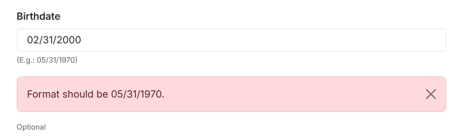
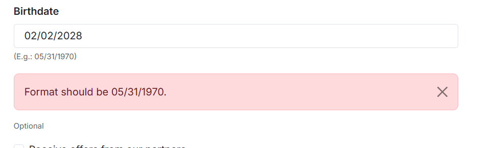
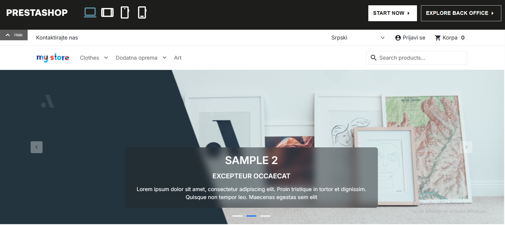
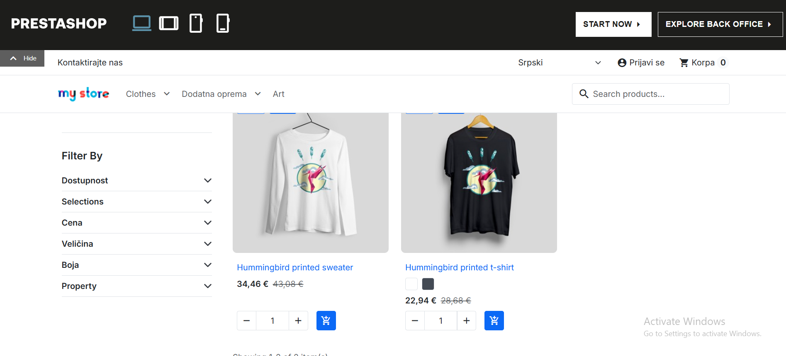
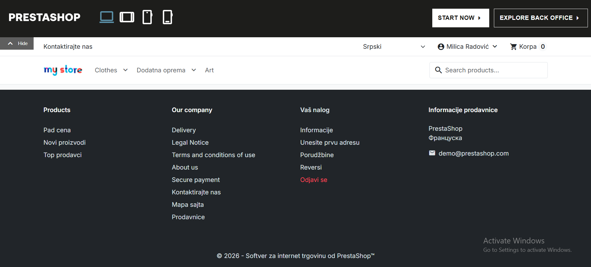
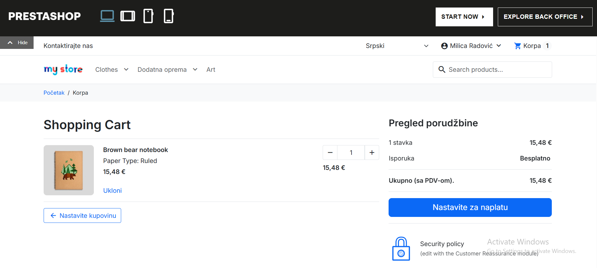
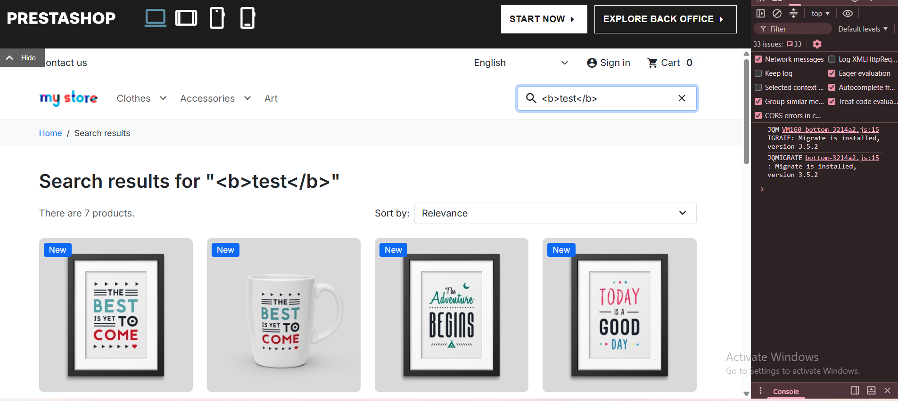
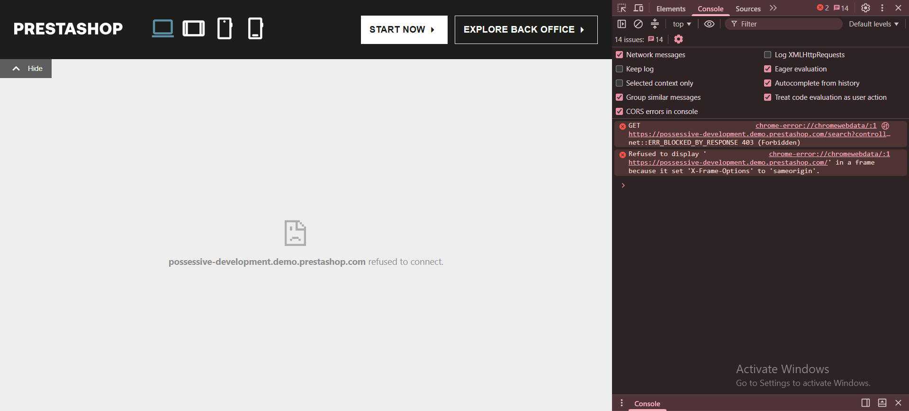

# Exploratory Testing Findings

I explored https://demo.prestashop.com/ for about 30 minutes, mostly the registration form and the store, and a bit of the back office. These are the three things I found. All of them are low severity. I repeated the search issue on 3 new demo shops, and the Serbian translation issue on a new shop too.

Environment: Chrome 153.0.8010.53 (64-bit), Windows, 25 Oct 2026

---

## 1. Birthdate: wrong message for a date that does not exist or is in the future

Type: Usability
Severity: Low

Steps to reproduce:
1. Open the demo and wait for the shop to load.
2. Click Sign in, then Create your account.
3. In the Birthdate field type 02/31/2000 (same format as the example, no dot at the end).
4. Click Create account.
5. Do the same with 02/02/2028.

Expected result:
A message that explains the real problem, for example "Please enter a valid date" or "Birthdate cannot be in the future".

Actual result:
For both dates I get "Format should be 05/31/1970." under the field and the form is not sent. The format is the same as the example, so the message is confusing.

Notes:
The date 02/02/2000 is accepted, so the format itself is fine and only the message is wrong. The message appears after I click Create account, not while I type. The field is optional.

Evidence:

---

## 2. Serbian language: texts are a mix of Serbian and English on many pages

Type: Usability / Localization
Severity: Low

Steps to reproduce:
1. Open the demo and wait for the shop to load.
2. In the header, change the language to Srpski.
3. Look at the header, the Clothes category, the footer, and the cart (add a product first).

Expected result:
All texts on the page are in Serbian.

Actual result:
Some texts are translated, but many stay in English:
- Header and category page: "Search products...", "Filter By", "Selections", "Property", "Showing 1-2 of 2 item(s)"
- Footer: "Products", "Our company", "Delivery", "Legal Notice", "Terms and conditions of use", "About us", "Secure payment". In the same footer, other links are in Serbian ("Novi proizvodi", "Mapa sajta", "Prodavnice").
- Cart: the page title "Shopping Cart", "Security policy" and "(edit with the Customer Reassurance module)"

Notes:
The last one is a text for the shop admin, but the customer can see it in the cart. I think it is a placeholder that was not removed.
Category and product names ("Clothes", "Art", "Brown bear notebook", "Paper Type: Ruled") are also in English. I think the shop owner adds these, so they are less important than the theme texts.
In the footer, under "PrestaShop", the country is written as "Француска" in Cyrillic, while the rest of the interface is in Latin script. It is a small inconsistency.

Evidence:

---

## 3. Search with a script tag shows "refused to connect"

Type: Usability / Robustness
Severity: Low

Steps to reproduce:
1. Open the demo and wait for the shop to load.
2. Type `` in the search field.
3. Press Enter.

Expected result:
The shop stays usable and shows a "no results" page or a message that this input is not allowed.

Actual result:
The shop is replaced by a browser page that says `possessive-development.demo.prestashop.com refused to connect`. The first part of the address is different on every new demo shop. In the console I see a POST request with 403 (Forbidden), then `SyntaxError: Unexpected token '<'... is not valid JSON`, and then a message about X-Frame-Options.

Notes:
The script did not run. I think the 403 is a security filter on purpose, so I am not reporting a vulnerability. It may also come from the demo hosting (for example a firewall) and not from PrestaShop itself. The problem is that the user gets no explanation and must reload the page.
It happened every time on 3 new shops. `<b>test</b>`, `<`, `a<b` and the word script all work normally, so only this exact tag is blocked.

Evidence:

---

## Checked, not a bug

- Registration: invalid input was rejected everywhere I tried it (weak password, first name with digits, email without @, empty required fields).
- Back office: adding a product shows "This functionality has been disabled". I think the demo does this on purpose, so I did not report it.